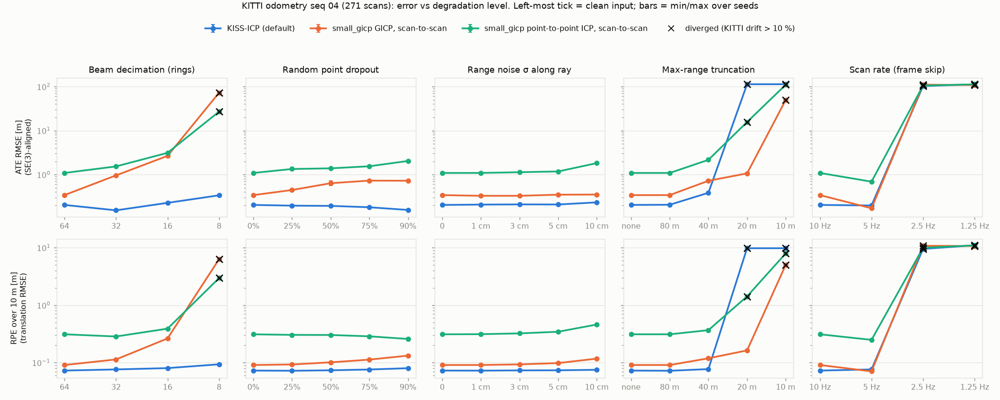
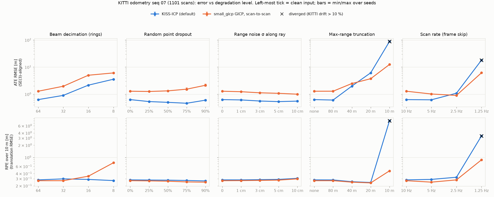
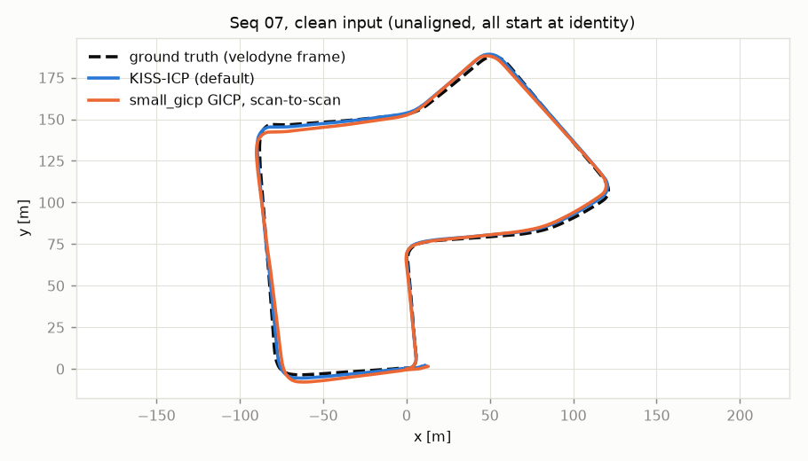

# LiDAR Odometry Under Degradation

**Where do KISS-ICP and GICP break when the LiDAR input gets worse?**

A controlled degradation study on real KITTI scans. It takes the Velodyne
HDL-64E scans of KITTI odometry sequence 04 (271 scans, 393.6 m of straight
road at a mean 14.6 m/s), applies five synthetic degradations at three or four
levels each, runs three odometry front ends on every degraded copy, and scores
the trajectories against KITTI ground truth. A first pass repeats the sweep on
sequence 07 (1101 scans, 694.4 m of residential streets at a mean 6.3 m/s,
ending 9.4 m from its start) with two of the methods. 135 runs, about 13
minutes on a laptop CPU.

> **Scope.** Two sequences, synthetic degradations of real scans, fixed
> default parameters for every method. The numbers describe these
> implementations on these sequences, not a sensor specification. See
> [Limitations](#limitations). This is a **draft**.



## Findings (sequence 04)

All drift values are the KITTI metric, which on this 394 m sequence uses only
the 100, 200 and 300 m segments. "Breaks" means flagged as diverged (drift
above 10 %). The full table is [`results/04.csv`](results/04.csv).

1. **Clean input gives sub-1 % drift for KISS-ICP and GICP.** KISS-ICP: 0.46 % drift, 0.20 m
   ATE, 0.07 m RPE over 10 m, 13.5 ms per scan. Scan-to-scan GICP: 0.52 %,
   0.34 m, 0.09 m, 9.7 ms. Scan-to-scan point-to-point ICP: 2.16 %, 1.09 m,
   0.31 m, 11.4 ms.
2. **Where each method breaks** (first level flagged within the sweep):

   | Degradation | KISS-ICP | GICP (scan-to-scan) | P2P ICP (scan-to-scan) |
   |---|---|---|---|
   | Beams 64 → 8 | not broken (0.61 % at 8 rings) | 8 rings | 8 rings |
   | Dropout to 90 % | not broken (≤ 0.53 %) | not broken (≤ 1.09 %) | not broken (≤ 3.27 %) |
   | Range noise to 10 cm | not broken (≤ 0.52 %) | not broken (≤ 0.54 %) | not broken (≤ 2.74 %) |
   | Max range 80 → 10 m | 20 m | 10 m | 20 m |
   | Scan rate 10 → 1.25 Hz | 2.5 Hz | 2.5 Hz | 2.5 Hz |

3. **Fewer rings hurts scan-to-scan GICP first; KISS-ICP barely notices.**
   KISS-ICP drifts 0.47, 0.54 and 0.61 % at 32, 16 and 8 rings. GICP goes to
   1.31 % at 32 rings and 3.25 % at 16, then diverges at 8 (64.8 %, ATE
   72.7 m). Point-to-point ICP goes 2.85 %, 4.23 %, then 22.5 %.
4. **How points are removed matters more than how many.** 90 % random dropout
   leaves 12.6k points per scan, fewer than the 16.1k of 8 rings. Yet GICP
   drifts 1.07–1.09 % under dropout (two seeds) instead of diverging, and
   KISS-ICP drifts 0.52 %. Dropout also makes KISS-ICP faster: 6.0 ms per
   scan at 90 %, against 13.5 ms clean.
5. **Range noise up to σ = 10 cm barely moves drift, but costs time.** At
   10 cm: KISS-ICP 0.51–0.52 %, GICP 0.49–0.53 %, ICP 2.58–2.74 % (two seeds
   each). Mean time per scan rises from 9.7 to 22.1 ms for GICP (13.1 and
   31.0 ms in the two seeds, so partly timing noise) and from 13.5 to 19.2 ms
   for KISS-ICP.
6. **Max range reverses the ranking.** The 80 m cut removes nothing on this
   sequence (125,718 points per scan either way). At 40 m KISS-ICP's drift
   more than doubles to 1.05 % (GICP 1.10 %). At 20 m KISS-ICP stops moving: its
   estimate covers 8.5 m of the 393.6 m path (100.5 % drift), while GICP holds
   at 2.23 %. At 10 m all three fail (GICP 55.7 %).
7. **Every method survives 5 Hz and none survives 2.5 Hz.** At 5 Hz: KISS-ICP
   0.48 %, GICP 0.46 %, ICP 1.20 %. At 2.5 Hz (about 5.8 m between scans) all
   three diverge (92.9–99.6 % drift). Their estimates travel 29.7–35.5 m of
   the 393.6 m, and KISS-ICP's median step is 0.48 m. Every method starts from
   a zero-motion guess, so this may be a start-up failure rather than a
   tracking limit (see Limitations).

## Findings (sequence 07, first pass)

KISS-ICP and GICP only (no ICP baseline yet). Drift here uses the 100–600 m
segments of the 694 m loop. The full table is
[`results/07.csv`](results/07.csv).

1. **Clean input.** KISS-ICP: 0.70 % drift, 0.63 m ATE, 9.9 ms per scan.
   GICP: 1.19 %, 1.29 m, 6.3 ms.
2. **Where each method breaks:**

   | Degradation | KISS-ICP | GICP (scan-to-scan) |
   |---|---|---|
   | Beams 64 → 8 | not broken (2.58 % at 8 rings) | not broken (4.17 % at 8 rings) |
   | Dropout to 90 % | not broken (≤ 0.67 %) | not broken (≤ 1.64 %) |
   | Range noise to 10 cm | not broken (≤ 0.70 %) | not broken (≤ 1.16 %) |
   | Max range 80 → 10 m | 10 m (56.3 %) | not broken (5.80 % at 10 m) |
   | Scan rate 10 → 1.25 Hz | 1.25 Hz (10.4 %) | not broken (8.96 % at 1.25 Hz) |

3. **The sequence 04 pattern holds, with later breaks.** Fewer rings again
   costs GICP more than KISS-ICP (8 rings: 4.17 % against 2.58 %), but
   nothing diverges on these streets. Range truncation again favours GICP: at
   10 m KISS-ICP's estimate covers 266.4 m of the 694.4 m path, while GICP
   drifts 5.80 %.
4. **Inter-scan motion, not scan rate, looks like the limit.** Both methods
   hold at 2.5 Hz here (0.72 % each), where all three failed on sequence 04.
   The car is slower (mean 6.3 m/s), so 1.25 Hz means about 5.0 m between
   scans, close to the 5.8 m of sequence 04 at 2.5 Hz. At that spacing both
   methods sit near the 10 % line (KISS-ICP 10.4 %, GICP 8.96 %). Two
   sequences are not enough to pin the number.
5. **The 10 m RPE has a floor on this sequence.** Clean input scores 0.28 m
   (KISS-ICP) and 0.27 m (GICP) over 10 m, against 0.07–0.09 m on sequence 04,
   and every dropout, noise and 80–20 m truncation run of both methods stays
   within 0.24–0.31 m. Something common to all runs dominates at that scale
   (possibly the ground truth); it was not investigated.





## Method

**Data.** KITTI raw drive `2011_09_30_drive_0016` (sync), frames 0–270, which
the odometry devkit maps to odometry sequence 04. The alignment is checked at
load time: the frame counts of the raw slice, `poses/04.txt` and `times.txt`
agree (271), and the raw Velodyne timestamps match `times.txt` to within
3.2 ms on every frame (the code asserts < 10 ms), so no frame is dropped or
duplicated inside the slice. Ground
truth (camera-0 frame) is moved into the Velodyne frame with the sequence's
calibration, `T_velo_i = Tr⁻¹ · T_cam_i · Tr`. Every method gets the same
input: the raw scan with KISS-ICP's KITTI vertical-angle correction
(`_correct_kitti_scan`, the same call its KITTI dataloader makes), then the
degradation. [`bench.py`](bench.py)

**Rings.** KITTI `.bin` files have no ring field. The points are stored one
laser after another, each sweep cut at the forward direction, so a new ring
starts wherever the azimuth steps from just below 0 to just above it. On all 279
raw scans of the drive this gives exactly 64 rings whose median elevation falls
strictly from top to bottom (frame 0: +2.3° to −23.7°, mean spacing 0.33° in
the upper 32 rings and 0.49° in the lower 32, the HDL-64E's two blocks). The
load step asserts both properties on every scan. Elevation is used as the check
rather than the label: assigning each point to the nearest ring-median
elevation disagrees with the scan-order ring for 11 %, 40 % and 29 % of the
points of frames 0, 135 and 270, at near and far range alike.

**Degradations** (one per run, everything else clean):

| Degradation | Levels | Seeds | How |
|---|---|---|---|
| Beam decimation | 64 → 32, 16, 8 rings | 1 | keep rings with `ring % (64/n) == 0` |
| Random dropout | 25, 50, 75, 90 % | 2 | i.i.d. Bernoulli per point |
| Range noise | σ = 1, 3, 5, 10 cm | 2 | Gaussian along the ray, direction kept |
| Max-range truncation | 80, 40, 20, 10 m | 1 | drop points beyond *R* (fog/occlusion proxy) |
| Scan rate | 10 → 5, 2.5, 1.25 Hz | 1 | keep every 2nd/4th/8th scan; GT subsampled to match |

Seeded draws are identical across methods (same seed, same scan order).

**Methods.**
- **KISS-ICP 1.3.0, default config**: scan-to-map point-to-point ICP with a
  robust kernel, voxel hash map (1.0 m voxels, from `max_range` 100 m / 100,
  20 points per voxel), adaptive correspondence threshold, constant-velocity
  prediction. No per-point timestamps are passed (as in its KITTI
  dataloader). The only change from the default config is
  `max_num_threads = 8`.
- **small_gicp 1.0.1 GICP, scan-to-scan**: scan *k* registered to scan *k − 1*
  (KD-tree target), 0.25 m voxel downsampling, covariances from 10 nearest
  neighbours, 1.0 m max correspondence distance, at most 20
  iterations, initial guess = the previous relative motion (constant velocity),
  8 threads.
- **small_gicp point-to-point ICP, scan-to-scan**: the same pipeline with
  `registration_type="ICP"`, as a plain baseline.

**Metrics** (all against GT in the Velodyne frame):
- **ATE RMSE**: evo APE on the translation, after an SE(3) Umeyama alignment
  (no scale).
- **RPE over 10 m and 50 m**: evo RPE, translation part, RMSE. Every pose
  starts a segment, ending at the pose whose GT path length from it is closest
  to 10 m (or 50 m), kept if within ±10 %. Pairs are picked on the GT, so every
  method is scored on the same segments. At low scan rates no pose pair is
  10 ± 1 m apart, and the 10 m RPE is left blank.
- **KITTI drift**: the devkit's average translational error over 100–800 m
  segments (the copy shipped in `kiss_icp.metrics`). Sequence 04 is 394 m long,
  so only the 100, 200 and 300 m segments exist; treat it as indicative.
- **Runtime**: wall-clock per scan for the whole odometry step (preprocessing,
  downsampling, registration, map update), excluding file I/O and the
  degradation. 8 threads per method on an Intel Core Ultra 7 255H (16
  hardware threads), one run per condition.
- **Divergence flag**: a run is flagged when its KITTI drift exceeds 10 %
  (about 20× the clean KISS-ICP value), a pose is non-finite, or the method
  throws. The threshold is a choice. It uses drift rather than a 10 m segment
  error because drift is defined at every scan rate. The CSV also keeps the
  worst 10 m segment error (`rpe10_max_m`), so the flag can be re-cut.

## Limitations

- **Two sequences.** Sequence 04 is 27 s of straight road (net heading
  change −0.1°), and 07 is one residential loop. Nothing is averaged over
  sequences, and the ICP baseline has only been run on 04.
- **Synthetic degradations of real scans.** Dropout is i.i.d., while real
  dropout is structured (dark or specular surfaces, rain, spray). Range noise
  is Gaussian and independent of range and incidence angle. Truncation removes
  far points but does not add the spurious near returns that fog and dust
  produce. Decimated beams keep the HDL-64E's elevation pattern, which is not
  the pattern of a real 16- or 32-beam sensor.
- **The first scan pair at low rate has no motion prior.** Every method starts
  from identity, so on sequence 04 at 2.5 Hz the first registration must close
  about 5.8 m from a zero guess (about 12 m at 1.25 Hz). Some rate failures may be initialisation failures rather
  than steady-state ones.
- **Defaults, not tuned systems.** No method was re-tuned per degradation. A
  GICP with a larger neighbourhood, or a scan-to-model GICP, would likely
  survive sparser input. The comparison is also not only GICP against
  point-to-point: KISS-ICP keeps a local map, the small_gicp variants here do
  not, so map vs. no map is confounded with the cost function.
- **Runtime is indicative.** One run per condition, on a laptop with other
  work running. A first pass at 16 threads was discarded: small_gicp's clean
  run took 20.2 ms/scan in one run and 29.0 in another, and 68 ms/scan in
  another condition, which is consistent with OpenMP threads stalling on a
  busy hybrid CPU. Both methods are now capped at 8 threads, and the clean
  GICP run takes 9.7 ms/scan.
- **Two seeds** per random degradation. A seed changes the degradation draw,
  not the scan.
- **No IMU.** FAST-LIO2 and other LiDAR-inertial methods need IMU data and ROS;
  they are the next comparison, not attempted here.

## Reproduce

Needs Python 3.10+ and about 1.7 GB of disk for sequence 04 (6.5 GB more for 07).

```bash
python3 -m venv ~/.venvs/lidar_bench
~/.venvs/lidar_bench/bin/pip install -r requirements.txt
./run_all.sh                 # self-check, download, extract, sweep seq 04, plot (~10 min)
SEQS="04 07" ./run_all.sh    # adds sequence 07 (4.4 GB download)
```

`KITTI_ROOT` (default `~/data/kitti`) sets the data directory. Outputs:
`results/<seq>.csv` (one row per run), `results/<seq>_sweep.png`,
`results/<seq>_clean_traj.png`, and per-run trajectories in KITTI format under
`results/traj/` (not committed).

## Data and license

KITTI is © Geiger, Lenz, Stiller and Urtasun and licensed
[CC BY-NC-SA 3.0](https://creativecommons.org/licenses/by-nc-sa/3.0/). No
KITTI data is redistributed in this repository; `run_all.sh` downloads it from
the official mirror. The result tables and figures are derived from KITTI and
are shared under the same CC BY-NC-SA 3.0 terms. The code is separate from the
data license.

## Software and data

- KITTI odometry and raw data: <https://www.cvlibs.net/datasets/kitti/>
- KISS-ICP: <https://github.com/PRBonn/kiss-icp>
- small_gicp: <https://github.com/koide3/small_gicp>
- evo: <https://github.com/MichaelGrupp/evo>

Formal paper references are not listed yet in this draft.
